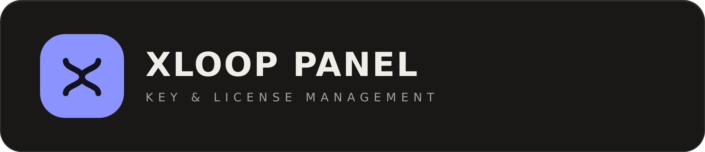
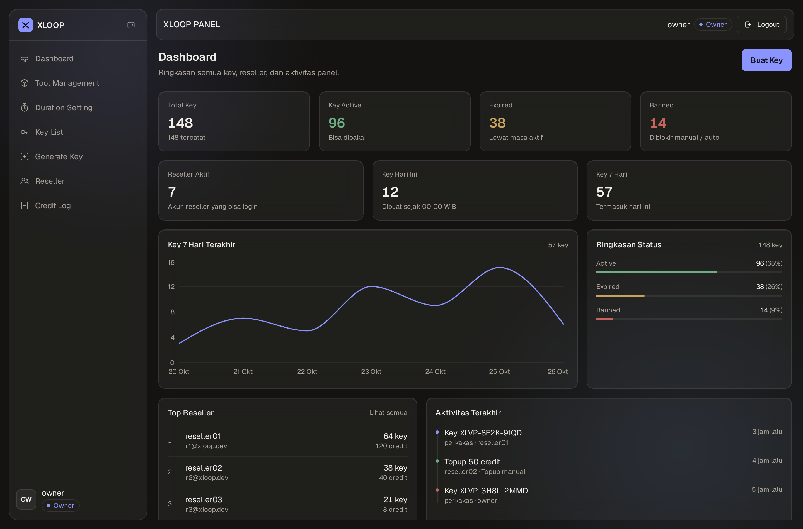
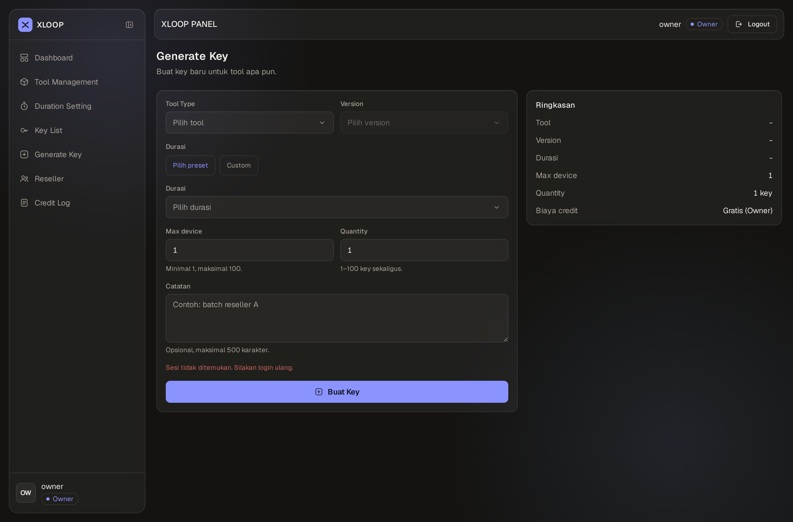
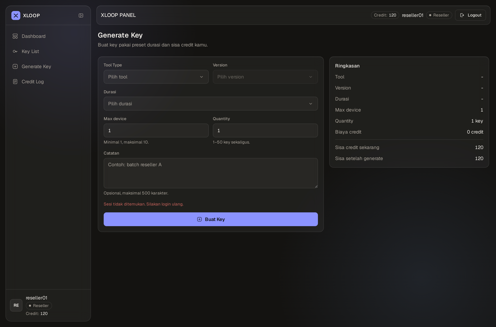
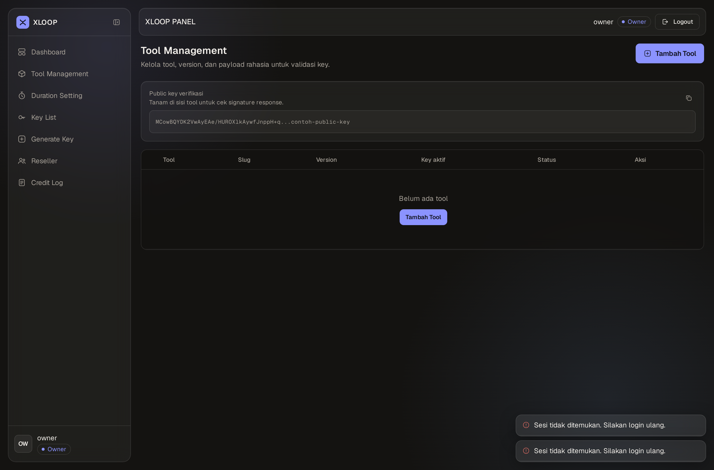
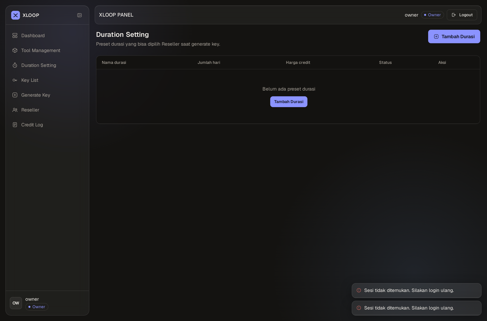
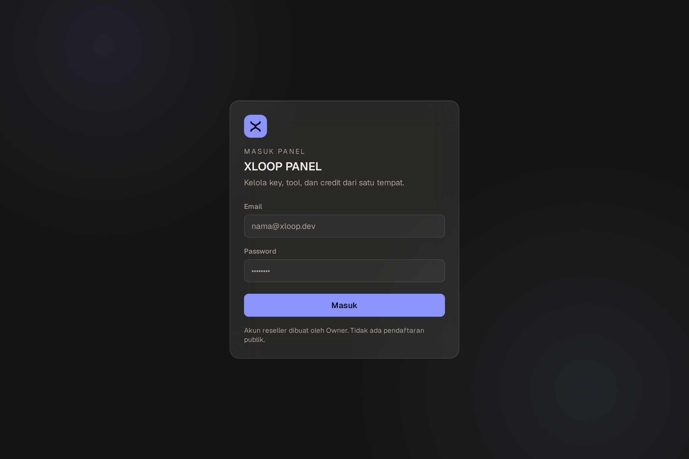
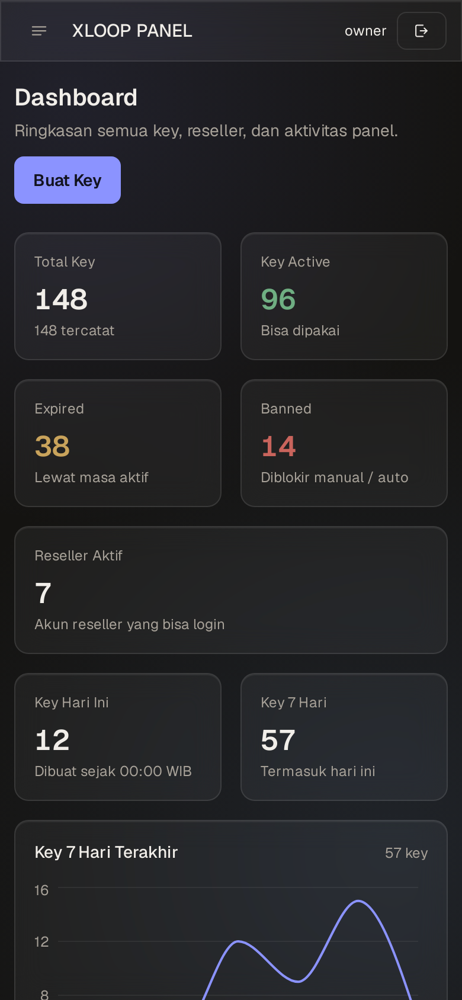
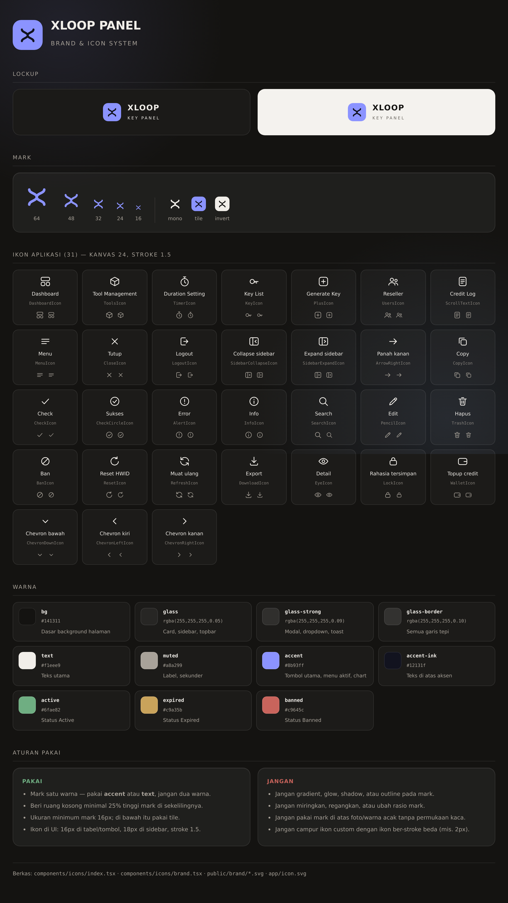
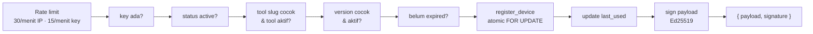

<div align="center">



### Key & license management panel — Next.js 14 · Supabase · Ed25519

Panel admin untuk mengelola lisensi key produk digital: katalog tool & version, preset durasi,
credit reseller, dan endpoint validasi publik yang response-nya **ditandatangani Ed25519** sehingga
tidak bisa dipalsukan di sisi client.

[](https://nextjs.org)
[](https://supabase.com)
[](https://www.typescriptlang.org)
[](https://tailwindcss.com)
[](https://vercel.com)

[Fitur](#-fitur) · [Pratinjau](#-pratinjau) · [Brand & ikon](#-brand--ikon) · [Mulai](#-mulai-cepat) · [API validasi](#-endpoint-validasi-anti-bypass) · [Deploy](#-deploy-ke-vercel)

</div>

---

## ✨ Fitur

| | Fitur | Owner | Reseller |
|---|---|:--:|:--:|
| 📊 | Dashboard statistik + chart 7 hari + aktivitas terakhir | semua data | data sendiri |
| 🧰 | Tool management (tool, version, toggle aktif, payload rahasia) | ✅ | ❌ |
| ⏱️ | Duration setting (preset hari + harga credit) | ✅ | ❌ |
| 🔑 | Key list (filter, sort, pagination, edit, ban/unban, hapus) | semua key | key sendiri |
| ➕ | Generate key (batch sampai 100 / 50, custom duration) | ✅ | preset only |
| 👥 | Reseller management (topup, aktif/nonaktif, reset password) | ✅ | ❌ |
| 🧾 | Credit log + export CSV | semua log | log sendiri |
| 🛡️ | HWID manager (reset per device / semua slot) | ✅ | ✅ |
| 🔐 | `/api/validate` bertanda tangan Ed25519 | publik, rate-limited |

<details>
<summary><b>Detail per halaman</b></summary>

**Dashboard** — kartu statistik dengan count-up (total / active / expired / banned, reseller aktif, key hari ini, key 7 hari),
grafik line 7 hari (`recharts`, di-load `next/dynamic` `ssr:false`), ringkasan status dengan progress bar,
Top 5 reseller (Owner) dan Recent Activity (10 aktivitas terakhir). Reseller melihat kartu **Sisa Credit** + tombol Buat Key.

**Tool Management** — CRUD tool + version, toggle aktif/nonaktif, dan **payload rahasia** per tool
(disimpan di `tool_secrets`; setelah tersimpan isinya tidak pernah dikirim balik ke browser, UI cuma menampilkan
"Tersimpan" + tombol "Ganti"). Ada kotak read-only **public key verifikasi** + tombol copy.

**Duration Setting** — preset durasi: nama, jumlah hari, harga credit, status. Preset nonaktif tidak muncul untuk Reseller.

**Key List** — search, filter (status / tool / version / reseller), sort, pagination. Kolom device `terpakai/max`,
copy key, detail HWID, edit, ban/unban, hapus. Status efektif dihitung dari tanggal expired, bukan cuma kolom `status`.

**Generate Key** — dua kolom: form + kartu **Ringkasan** sticky (tool, version, durasi, biaya credit, sisa credit setelah generate).
Hasil generate bisa di-copy per key, copy semua, dan export `.txt`.

**Reseller** — tambah akun (langsung aktif tanpa verifikasi email), detail + riwayat credit, topup
(termasuk penyesuaian negatif), aktif/nonaktifkan, reset password, hapus.

**Credit Log** — filter aksi & rentang tanggal, filter reseller (Owner), export CSV (UTF-8 BOM).

</details>

---

## 📸 Pratinjau

<div align="center">

**Dashboard Owner**



<table>
<tr>
<td width="50%"><br/><sub><b>Generate Key</b> — form + ringkasan live</sub></td>
<td width="50%"><br/><sub><b>Tampilan Reseller</b> — preset & credit</sub></td>
</tr>
<tr>
<td><br/><sub><b>Tool Management</b> — tool, version, secret</sub></td>
<td><br/><sub><b>Duration Setting</b> — preset & harga credit</sub></td>
</tr>
</table>




<sub>Login (kiri) · layout mobile dengan drawer (kanan)</sub>

</div>

---

## 🎨 Brand & ikon

Semua ikon di UI **custom**, bukan icon library — 31 ikon SVG di kanvas 24px, stroke 1.5, gaya geometris
yang senada dengan brand mark. Mark-nya "X" yang dibangun dari dua loop cermin: terbaca sebagai huruf X,
lengkungnya memberi isyarat *loop*.

<div align="center">

</div>

| Aset | Lokasi |
|---|---|
| Komponen ikon (31) | [`components/icons/index.tsx`](components/icons/index.tsx) |
| Brand mark & tile (`XloopMark`, `XloopTile`, `XloopLogo`) | [`components/icons/brand.tsx`](components/icons/brand.tsx) |
| SVG siap pakai | [`public/brand/`](public/brand) — `xloop-favicon.svg`, `xloop-mark.svg`, `xloop-mark-accent.svg`, `xloop-logo.svg` |
| Favicon aplikasi | [`app/icon.svg`](app/icon.svg) |
| Brand sheet (HTML, bisa dibuka di browser) | [`docs/brand.html`](docs/brand.html) |

**Aturan pakai singkat:** mark satu warna (`accent` atau `text`), ruang kosong minimal 25% tinggi mark,
ukuran minimum 16px (di bawah itu pakai tile), ikon UI 16px di tabel/tombol & 18px di sidebar.
Jangan gradient, glow, shadow, atau mengubah rasio mark.

<details>
<summary><b>Palet warna</b></summary>

| Token | Nilai | Dipakai untuk |
|---|---|---|
| `bg` | `#141311` | dasar background halaman |
| `glass` | `rgba(255,255,255,0.05)` | card, sidebar, topbar |
| `glass-strong` | `rgba(255,255,255,0.09)` | modal, dropdown, toast |
| `glass-table` | `rgba(20,19,17,0.72)` | container tabel |
| `glass-border` | `rgba(255,255,255,0.10)` | semua garis tepi |
| `text` | `#f1eee9` | teks utama |
| `muted` | `#a8a299` | label, teks sekunder |
| `accent` | `#8b93ff` | tombol utama, menu aktif, chart |
| `accent-ink` | `#12131f` | teks di atas tombol aksen |
| `active` | `#6fae82` | status Active |
| `expired` | `#c9a35b` | status Expired |
| `banned` | `#c9645c` | status Banned |

Aksen **periwinkle** dipilih karena jauh dari seluruh warna status (hue 236°, jarak ≥ 98° dari Active/Expired/Banned),
jadi tombol dan badge status tidak berebut perhatian. Kontras 6,8:1 di atas `bg`.
Perbandingan 6 kandidat warna ada di [`docs/accent-options.html`](docs/accent-options.html).

</details>

---

## 🧱 Tech stack

| Layer | Teknologi |
|---|---|
| Frontend & backend | Next.js **14.2** App Router (Route Handlers) |
| Database & auth | Supabase (PostgreSQL + Auth) |
| Client | `@supabase/ssr` + `@supabase/supabase-js` |
| Styling | Tailwind CSS 3.4 — dark only, glassmorphism |
| Animasi | framer-motion 11 (page transition, shared layout, reveal, count-up) |
| Chart | recharts (dynamic import, hanya dashboard) |
| Ikon | custom SVG set (31 ikon) di `components/icons` — tanpa icon library |
| Font | Geist Sans + Geist Mono (`next/font`) |
| Deploy | Vercel + Vercel Cron |
| Node | 20.9+ (disarankan 24 LTS, lihat `.nvmrc`) |

---

## 🗂️ Struktur proyek

```text
xloop-panel/
├── app/
│   ├── (auth)/login/              # halaman login
│   ├── (dashboard)/               # shell + halaman dashboard, tools, durations, keys, generate, resellers, credits
│   ├── api/
│   │   ├── auth/                  # login, logout
│   │   ├── keys/                  # list, generate, edit, hapus, ban/unban, devices
│   │   ├── tools/                 # tool, version, secret
│   │   ├── durations/             # preset durasi
│   │   ├── resellers/             # reseller, topup, password
│   │   ├── credits/               # credit log
│   │   ├── dashboard/ me/         # data dashboard & profil aktif
│   │   ├── validate/              # validasi key publik (Ed25519)
│   │   └── cron/cleanup/          # cron harian
│   ├── globals.css                # token warna + utility glass
│   └── icon.svg                   # favicon
├── components/
│   ├── dashboard/                 # KeyTable, HwidModal, KeyEditModal, chart, kartu statistik…
│   ├── icons/                     # 31 ikon custom + brand mark
│   ├── layout/                    # Sidebar, MobileDrawer, Topbar, PageHeader, PageTransition, DashboardShell
│   └── ui/                        # Button, Modal, Select, Badge, Toast, Skeleton, GlassCard, Reveal, AnimatedNumber…
├── lib/
│   ├── api/                       # helper auth API, response, fetch client
│   ├── supabase/                  # client (browser), server, admin (service role)
│   └── utils/                     # format, tanggal, status, keygen, signing, tipe
├── public/brand/                  # aset SVG brand
├── docs/                          # CLIENT_INTEGRATION.md, brand.html, accent-options.html, screenshots
├── scripts/generate-keypair.mjs   # generator keypair Ed25519
├── migration.sql                  # skema + RLS + functions (siap run)
├── middleware.ts                  # proteksi session
└── vercel.json                    # cron harian
```

---

## 🚀 Mulai cepat

### 1. Prasyarat

- Node.js **20.9+** (disarankan 24 LTS)
- Project Supabase (gratis cukup)

### 2. Install & environment

```bash
git clone <repo-kamu> xloop-panel
cd xloop-panel
npm install
cp .env.example .env.local
```

Isi `.env.local` (tabel lengkap di [Environment variables](#-environment-variables)):

```dotenv
NEXT_PUBLIC_SUPABASE_URL=https://xxxx.supabase.co
NEXT_PUBLIC_SUPABASE_ANON_KEY=eyJhbGciOi...
SUPABASE_SERVICE_ROLE_KEY=eyJhbGciOi...      # server only

LICENSE_SIGNING_PRIVATE_KEY=                  # isi dari langkah 4
LICENSE_SIGNING_PUBLIC_KEY=
CRON_SECRET=ubah-jadi-random-panjang
```

### 3. Migrasi database

Buka **Supabase → SQL Editor → New query**, tempel seluruh isi [`migration.sql`](migration.sql), lalu **Run**.

<details>
<summary>Yang dibuat oleh <code>migration.sql</code></summary>

- Tabel: `profiles`, `tool_types`, `tool_versions`, `duration_presets`, `keys`, `device_logs`, `credit_logs`, `tool_secrets`, `validation_attempts`
- Index untuk semua kolom filter & sort
- Fungsi: `is_owner()`, `register_device()` (atomic, anti race slot terakhir), `update_expired_keys()`, `cleanup_validation_attempts()`
- Trigger `updated_at` untuk semua tabel utama
- **RLS + policy** per tabel (reseller hanya baca miliknya). `tool_secrets` & `validation_attempts` RLS aktif tanpa policy → hanya service role
- 3 preset durasi contoh (boleh dihapus)

</details>

### 4. Generate keypair signature

```bash
npm run keypair
```

Output dua baris base64 — tempel ke `LICENSE_SIGNING_PRIVATE_KEY` dan `LICENSE_SIGNING_PUBLIC_KEY`.
Private key hanya dipakai server (`/api/validate`); public key aman dibagikan dan ditanam di sisi tool.

### 5. Buat Owner pertama

Belum ada halaman register publik — Owner pertama dibuat manual:

1. Supabase → **Authentication → Users → Add user** (isi email + password, centang **Auto Confirm User**)
2. Salin **UUID** user tersebut
3. Jalankan di SQL Editor:

```sql
insert into profiles (id, username, email, role, credit, is_active)
values ('<UUID-USER>', 'owner', 'owner@xloop.dev', 'owner', 0, true)
on conflict (id) do update set role = 'owner', is_active = true;
```

4. Login di `/login` → tambah tool → tambah version → buat key pertama.
   Reseller dibuat dari halaman **Reseller → Tambah Reseller**.

### 6. Jalankan

```bash
npm run dev      # http://localhost:3000
npm run build    # build produksi
```

> Kalau env Supabase belum diisi, panel menampilkan halaman instruksi setup (503) alih-alih error 500.

---

## 🔑 Environment variables

| Variabel | Scope | Keterangan |
|---|---|---|
| `NEXT_PUBLIC_SUPABASE_URL` | browser + server | Project URL Supabase |
| `NEXT_PUBLIC_SUPABASE_ANON_KEY` | browser + server | anon key — dilindungi RLS |
| `SUPABASE_SERVICE_ROLE_KEY` | **server only** | melewati RLS. Jangan pakai prefix `NEXT_PUBLIC_` |
| `LICENSE_SIGNING_PRIVATE_KEY` | **server only** | PKCS8 PEM Ed25519 (base64) |
| `LICENSE_SIGNING_PUBLIC_KEY` | server | SPKI PEM Ed25519 (base64), ditampilkan di Tool Management |
| `CRON_SECRET` | server | Bearer token untuk `/api/cron/cleanup` |

---

## 🛡️ Endpoint validasi (anti-bypass)

`POST /api/validate` — publik, tanpa CORS wildcard, service role, `no-store`.

```jsonc
// request (maks 2 KB)
{
  "key": "XLVP-AB12-CD34",
  "tool_slug": "perkakas",
  "tool_version": "1.8.0",
  "hardware_id": "sha256_hash_of_device_info",
  "nonce": "random_baru_tiap_request"
}
```



**Response sukses** (ditandatangani, `signature` atas byte JSON payload sebelum di-base64):

```json
{ "payload": "<base64 JSON>", "signature": "<base64 Ed25519>" }
```

Payload berisi `valid`, `tool`, `version`, `expired_at`, `max_device`, `current_devices`,
`hardware_id`, `nonce`, `server_time`, dan `secret_payload` (isi `tool_secrets` — hanya dikirim setelah semua validasi lolos,
inilah yang membuat patch `false` → `true` di client jadi tidak berguna).

**Response gagal** (tanpa signature — client wajib menganggap gagal):

```json
{ "valid": false, "reason": "key_expired" }
```

| Reason | HTTP | Arti |
|---|:--:|---|
| `invalid_request` | 400 | body/format tidak valid |
| `invalid_key` | 200 | key tidak ditemukan |
| `key_expired` | 200 | lewat tanggal expired |
| `key_banned` | 200 | key dibanned |
| `wrong_tool` | 200 | `tool_slug` tidak cocok |
| `wrong_version` | 200 | `tool_version` tidak cocok |
| `device_limit_exceeded` | 200 | slot device penuh, HWID tidak dikenal |
| `rate_limited` | 429 | terlalu banyak request |
| `signing_unavailable` | 500 | keypair belum diset di env |

**Pengaman tambahan**

- 🚦 **Rate limit** 30 req/menit per IP & 15 req/menit per key — dihitung dari tabel `validation_attempts`, bukan memori (aman untuk serverless)
- 🕵️ **Anti-enumeration** — setelah 5× `invalid_key` dalam 10 menit dari satu IP, semua kegagalan berikutnya dikembalikan sebagai `invalid_key`
- 🚫 **Auto-ban** — key yang ditolak `device_limit_exceeded` oleh ≥ 5 HWID berbeda dalam 1 jam otomatis jadi `banned`
- 🧹 **Cleanup harian** — Vercel Cron → `GET /api/cron/cleanup` (`Authorization: Bearer CRON_SECRET`): hapus attempt > 7 hari + `update_expired_keys()`

Panduan integrasi sisi tool (alur 7 langkah + contoh kode **Python** & **JavaScript**): [`docs/CLIENT_INTEGRATION.md`](docs/CLIENT_INTEGRATION.md)

---

## 🔒 Keamanan & aturan penulisan data

- **Browser hanya membaca** lewat RLS (anon key). Semua tulis (key, device, credit, tool, reseller) **via API route** dengan service role setelah cek session + role + kepemilikan data di server.
- Reseller tidak bisa menulis langsung ke `keys` / `device_logs` / `credit_logs` — policy hanya `SELECT` untuk data miliknya.
- Perubahan credit memakai **optimistic locking** (`update ... where credit = nilai_lama`) supaya dua transaksi paralel tidak membuat saldo minus.
- `register_device()` mengunci baris key (`FOR UPDATE`) → dua request yang berebut slot terakhir tidak bisa dua-duanya lolos.
- `secret_payload`, private key, dan service role key **tidak pernah** di-log atau dikirim ke browser.
- Key dibuat dengan `crypto.randomInt` (bukan `Math.random`) + cek duplikat ke database sebelum insert.

---

## ☁️ Deploy ke Vercel

1. Push repo ke GitHub → **Vercel → Add New Project → Import**
2. Framework preset **Next.js** (build & output otomatis)
3. Tambahkan **Environment Variables** (Production + Preview): lihat tabel [di atas](#-environment-variables)
4. **Deploy**
5. Cron sudah terdaftar di [`vercel.json`](vercel.json) → `/api/cron/cleanup` tiap hari 03:00 UTC (Vercel mengirim `Authorization: Bearer $CRON_SECRET` otomatis)
6. Buka **Tool Management** → copy public key → tanam di sisi tool

<details>
<summary><b>Troubleshooting</b></summary>

| Masalah | Solusi |
|---|---|
| Login "Email atau password salah" | Pastikan user ada di `auth.users`, sudah dikonfirmasi, dan punya baris di `profiles` |
| "Akun kamu dinonaktifkan" | Set `profiles.is_active = true` |
| "Profil tidak ditemukan" | Insert `profiles` untuk UUID user tersebut |
| `invalid_request` dari `/api/validate` | Cek format key `XLVP-XXXX-XXXX`, nonce 16–64, hardware_id 16–128, body ≤ 2 KB |
| `signing_unavailable` | `LICENSE_SIGNING_PRIVATE_KEY` belum diset / base64 salah → `npm run keypair` |
| `wrong_version` | Nilai `tool_version` di tool harus sama persis dengan nama version (mis. `1.8.0`) |
| Cron 401 | Header Authorization tidak cocok dengan `CRON_SECRET` |
| Reseller tidak bisa generate | Cek credit, status tool/version aktif, dan preset durasi aktif |
| Halaman 503 "Environment Supabase belum diset" | `.env.local` belum berisi URL/anon key, atau server belum di-restart |
| Warning build `process.version … Edge Runtime` | Berasal dari `@supabase/supabase-js` di middleware (Edge). Tidak berbahaya, build tetap sukses |

</details>

---

## 📚 Dokumentasi

| Dokumen | Isi |
|---|---|
| [`docs/CLIENT_INTEGRATION.md`](docs/CLIENT_INTEGRATION.md) | Integrasi sisi tool: alur verifikasi, hardware ID, contoh Python & JS, praktik aman |
| [`docs/brand.html`](docs/brand.html) | Brand sheet: lockup, mark, galeri 31 ikon, palet, aturan pakai |
| [`docs/accent-options.html`](docs/accent-options.html) | Perbandingan 6 kandidat warna aksen + angka kontras |
| [`migration.sql`](migration.sql) | Skema database, RLS, functions — siap run |
| [`scripts/generate-keypair.mjs`](scripts/generate-keypair.mjs) | Generator keypair Ed25519 (`npm run keypair`) |

---

<div align="center">
<sub>Dibangun dengan Next.js 14, Supabase, dan Tailwind CSS. Ikon & brand mark custom.</sub>
</div>
